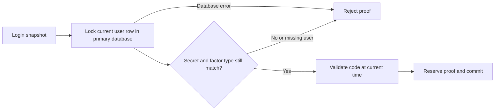

# AFTA remediation: reject stale MFA login state

Date: **11 November 2026**. Checklist row 36, `FIA_UAU.5.2`; related gap G-14.
This is a scoped implementation improvement, not AFTA approval.

## Management summary

A login request can hold an older copy of a user's second-factor settings.
Previously, replacing an email challenge or changing a factor after that copy
was loaded could leave the older code acceptable to the login replay guard.
The guard now checks the current database secret and factor type before accepting
that proof. A mismatch, deleted user or failed database read cannot produce an
accepted reservation.

## Code trace and ordering

[TwoFactorReplayService.consume](../../../dhis-2/dhis-services/dhis-service-core/src/main/java/org/hisp/dhis/security/twofa/TwoFactorReplayService.java)
reads `userinfo.secret` and `userinfo.twofactortype` by the stable UID directly
through the primary application `jdbcTemplate`. The query uses `FOR UPDATE`,
bypassing ORM caches and locking the row inside the existing `REQUIRES_NEW`
transaction. It compares both fields with the login snapshot before validating
and reserving the code. Time is captured after the lock is acquired, so waiting
for an update does not extend code validity. The lock is released when that
independent transaction commits or rolls back.

If a factor update locks the row first, consumption waits, then checks the
committed replacement state. If consumption locks first, a concurrent factor
update waits until that consumption completes. This defines ordering at proof
consumption; it cannot undo authentication already accepted before a later reset.
No code, seed or password is added to log messages or the replay ledger.

Only the existing internal guard changes. No new dependency, schema migration,
API, configuration flag or browser-app modification is required. Existing
single-use state and the prior disabled-factor rule remain in force.

## Verification

**102 targeted cases pass, with no failures, errors or skips:** 21 provider
policy, 21 H2 guard, 52 authentication/MFA API and 8 isolated PostgreSQL cases.
The embedded WAR build passes using existing browser assets; packaged guard and
provider classes match the compiled classes, and the PDF dependency check passes.
These counts overlap the 9 November inventory; they are not additional closed
requirements or a full-suite/browser acceptance claim.

The H2 reservation tests add rejection of a replaced email challenge, changed
TOTP seed, changed factor type and deleted user. They also check that rejection
does not reserve an obsolete challenge and a replacement challenge can succeed.

The isolated PostgreSQL tests add committed email replacement, factor reset,
denied authoritative-state read and a real update race. The race observes a
writer waiting on a database lock, commits a replacement and requires the stale
proof to be rejected without a replay record. Existing repeated/concurrent proof,
rollback, migration, schema-validation and denied-insert cases remain.

See the [dated machine-readable results](../evidence/afta-factor-state-freshness-2026-11-11.json)
for exact test counts, source hashes and packaging checks.

## Deployment and limits

Update every login node; older nodes do not apply this check. The application
writer must be able to read and lock the existing user row as well as write the
replay ledger. Lock contention or database failure can delay or fail login;
monitor database availability and use the deployment's normal transaction limits.
The deployment was not restarted as part of these checks.

This checks second-factor secret/type freshness at consumption. It does not
establish password/account/role/session freshness across every authentication
provider, invalidate existing sessions, prevent a state change after acceptance,
or detect reset-and-restore to identical secret/type values. Enrollment, disable,
recovery and other verification purposes remain outside this login-only guard.
Full deployed browser/multi-node acceptance, trusted time, backup/restore and
exact AFTA policy definitions remain open. The checklist stays Partial evidence;
its percentages do not change merely because a subgap is corrected.

Implementation commit: `685579cd43e53b86fcaecd1570a9d74ece54b16c`.
