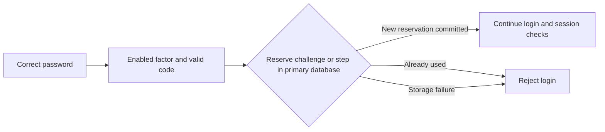

# AFTA remediation: single-use two-factor login codes

Date: **9 November 2026**. Related checklist item: row 36, `FIA_UAU.5.2`;
broader finding: G-14. No unselected SFR is added to the user-selected checklist by this hardening. **Implementation and targeted evidence; not full AFTA approval.**

## Management summary

A valid second-factor login code must not be reusable. The provider now requires
a database reservation before accepting a code. Email challenges can be reserved
once; authenticator codes can be reserved once per accepted time step and seed.
Independent application instances use the same primary database constraint.
A database error prevents acceptance rather than allowing password-only access.

The user account/seed is not cleared to implement this control. That avoids
reopening a code when an unrelated concurrent user update saves an older object.
The new internal table stores a SHA-256 fingerprint and retention deadline,
**not raw codes, seeds or user identifiers**. This statement concerns the new
table; it does not change existing user-secret storage or close encryption gaps.

## Behavior and boundaries

- **Email:** the reservation is bound to the user's stable UID and the complete code/expiry challenge. A distinct replacement challenge has separate state. The existing generated 15-minute validity is not extended; expiry is now rejected at the deadline itself. Malformed or overflowing stored expiry values reject validation.
- **TOTP:** validation still uses the existing AeroGear implementation and its current/previous 30-second-step window. The matched counter, seed and UID identify the reservation. A subsequent counter can be accepted; the previous counter cannot be used again while it remains valid. Enrollment seed lengths supported by the existing validator are retained.
- **Transactions:** `REQUIRES_NEW` commits the reservation independently before authentication returns. A later session error, caller transaction rollback or lost response must not make an accepted code reusable. The user may need a fresh email challenge or next authenticator code when retrying.
- **Retention:** reservations remain for **24 hours beyond their code-validity window**, then are cleaned during a valid consumption attempt. This is an engineering cleanup margin against bounded clock skew, not a claim that codes remain valid for 24 hours. It does not establish trusted time or protection against arbitrary clock rollback/incorrect server clocks.
- **Failure:** duplicate reservations return the existing incorrect-code result. Missing/unwritable replay storage raises a failure before authentication can be returned. Ordinary non-enrolled password login and the prior disabled-factor rejection remain unchanged.
- **Scope:** this patch consumes **login** proofs. Existing enrollment/disable/other management verification helpers remain separate. Cross-purpose single-use policy, factor-change freshness, browser recovery, restore of an old database snapshot and full deployed multi-node acceptance remain open.

## Code trace

| Artifact | Purpose |
| --- | --- |
| [TwoFactorAuthenticationProvider](../../../dhis-2/dhis-services/dhis-service-core/src/main/java/org/hisp/dhis/security/spring2fa/TwoFactorAuthenticationProvider.java), `validate2FACode` | Requires validation plus reservation before returning successful authentication. |
| [TwoFactorReplayService](../../../dhis-2/dhis-services/dhis-service-core/src/main/java/org/hisp/dhis/security/twofa/TwoFactorReplayService.java), `consume` | Validates at one captured time, derives the challenge/step fingerprint, cleans sufficiently old state and atomically reserves the unique key. Uses the primary `jdbcTemplate`, not an analytics or read-only connection. |
| [TwoFactorAuthUtils](../../../dhis-2/dhis-services/dhis-service-core/src/main/java/org/hisp/dhis/security/twofa/TwoFactorAuthUtils.java) | Keeps existing public verification methods, adds deterministic-time internal helpers using the existing OTP implementation, and handles strict email expiry/invalid expiry input. |
| [UsedTwoFactorCode](../../../dhis-2/dhis-services/dhis-service-core/src/main/java/org/hisp/dhis/security/twofa/UsedTwoFactorCode.java) | Internal persistence mapping for schema validation and H2 test schema creation; no generic metadata API is added. |
| [Fork-specific repeatable migration](../../../dhis-2/dhis-support/dhis-support-db-migration/src/main/resources/org/hisp/dhis/db/migration/pardas/R__PardasHealth_two_factor_login_replay.sql) | Creates `usedtwofactorcode` and its cleanup index without updating user records or dropping data. Uses the existing Flyway root location and a fork-owned repeatable name, avoiding competition with upstream numbered migrations. |

## Verification

**94 targeted cases pass, with no failures, errors or skips:** 21 provider-policy,
17 deterministic H2 reservation/transaction cases, 52 API/controller cases and
four PostgreSQL/Flyway cases. The 52 API cases include nine dedicated MFA login
checks, including fresh-email-challenge recovery using the project fake sender.
The packaged WAR and PDF dependency checks pass; existing browser assets were
reused rather than downloaded anew. These overlap the earlier test inventory
and are not added blindly to it.

- Provider-policy regressions include consumed-code rejection, storage failure, enabled/disabled factors, ordinary login, lockout, enrollment and external/non-form restrictions.
- H2/Spring-transaction tests cover email/TOTP reuse, eight concurrent guard instances per factor, independent transaction persistence through outer rollback, service recreation, storage failure, wrong/expired/malformed code handling, normalized input, user/challenge isolation, allowed time steps, cleanup and bounded-skew retention.
- A regression reproduced an early-cleanup defect: a faster node could remove a record still needed by a slower node. The added retention margin makes that scenario reject reuse.
- Security-chain API tests assert the response's login status and redirect, including a second login with the same code. HTTP 200 alone is not treated as successful authentication.
- Isolated PostgreSQL tests exercise real Flyway repeatable discovery/idempotence and Hibernate validation of the resulting PostgreSQL schema, concurrent email/TOTP reservation, outer rollback/service replacement and denied INSERT with a non-superuser writer.

Final counts, source hashes, commands and packaging checks are in the
[dated evidence record](../evidence/afta-replay-protection-2026-11-09.json).
These are scoped tests, not a full suite, browser acceptance test, physical power-loss
proof or independent evaluation. The PostgreSQL fixture uses temporary storage;
it does not prove backup/restore or production storage durability.

## Upgrade and operation

1. Use the platform's backed-up update path and retain the previous matching application/database/data recovery set. The migration is additive and idempotent; do not skip required migrations.
2. All authentication nodes must use the guarded implementation and authoritative database before claiming cross-node enforcement. Older nodes do not consult the ledger.
3. Protect the replay table and database access, keep clocks synchronized and monitor database capacity/availability. The cleanup margin is not a replacement for those controls.
4. Do not clear replay state to resolve login failures. Obtain a new challenge/code. Restoring an older database can restore older security state; agree a recovery procedure for invalidating outstanding proofs before reopening authentication.
5. Keep the production browser/CSRF gap and the exact AFTA definitions visible. Local CSRF-off development mode does not close production acceptance.

The selected checklist remains **partially evidenced**. This closes a concrete
login replay implementation gap, not every requirement associated with MFA,
trusted time, fault tolerance, cryptographic operations or secure deployment.

Implementation commit: `85c6310a5bca76251f9981266570b0ab8046a85d`.
