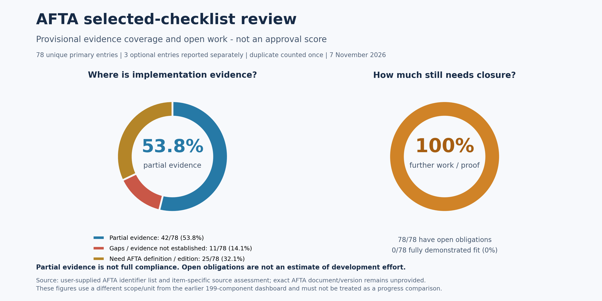

# AFTA selected-checklist review and gap report

**Date:** 7 November 2026. **Source identified by user:** AFTA; exact checklist title/version and full clause definitions not supplied.

**Scope:** only the supplied 82 numbered entries. This is a separate, narrower work list; it does not replace or declare completion of the broader Common Criteria review. An official evaluation may require dependencies or assurance work beyond this list. Those need explicit agreement rather than silent expansion here.

Implementation follow-up: **12 November 2026**. See the [remediation progress record](afta-remediation-progress.md) for MFA fixes, [PAT owner binding](afta-token-owner-binding.md) and [external broker TLS](afta-external-broker-tls.md). Broker-path evidence moves row 47 from a gap to partial evidence; no complete item is closed.

## Manager summary

**Demonstrated full fit: 0 of 78 (0%). Partial implementation evidence: 43 of 78 (55.1%). All 78 still need some work, definition or proof (100%).** These figures describe this checklist review; they do not mean the application is 0% secure, that 55.1% is certified, or that all development must be redone.

| Result for primary work list | Count | Percentage | Meaning |
| --- | ---: | ---: | --- |
| Fully demonstrated fit | 0 | 0.0% | No item has complete agreed AFTA definition/operations and sufficient end-to-end evidence to close it. |
| Partial evidence | 43 | 55.1% | Relevant implementation is identified, but full requirement coverage or acceptance is incomplete. |
| Gap / evidence not established | 10 | 12.8% | The selected guarantee is not established by the reviewed evidence. This is not an exhaustive proof that code is absent. |
| Definition or edition unresolved | 25 | 32.1% | The exact extension, iteration or edition must be obtained before a valid fit decision. |
| Still require work or evidence | 78 | 100.0% | Includes every partial, gap and unresolved item above; not an additional category. |

The primary denominator is **78 unique entries not explicitly marked optional**, not an approved declaration that all 78 are mandatory. Three explicitly optional entries are shown separately: one has partial evidence and two need definitions. Including optional items gives **81 unique entries: 44 partial (54.3%), 10 gaps (12.3%) and 27 unresolved (33.3%); 0 fully closed**. The source has 82 rows because rows 80 and 81 repeat the same identifier.

Do not compare these percentages directly with the earlier 199-component chart: this report counts selected **element/iteration identifiers**, while the earlier report counts broader components. Neither measures effort, time, cost or certification probability. No arbitrary half-credit or estimated compliance percentage is assigned to partial evidence.

## What needs management attention

1. **Confirm the AFTA checklist version and exact requirements.** Resolve extensions, crypto iterations, edition changes and the duplicated certificate identifier. This unblocks 25 primary items from a valid fit decision.
2. **Make the selected production release work securely.** Retain artifact-integrity checks after the user-confirmed successful startup on 9 November; fix and test the CSRF-aware production browser login integration. Local CSRF-off development mode is explicitly excluded from security acceptance.
3. **Close the important behavior gaps.** Prioritize audit retention/full-storage policy, encryption and MFA rules, access control, integrity/tamper response, reliable time, session history/fault tolerance and protected connections according to the selected requirements.
4. **Collect item-specific proof.** Complete the defined positive/negative tests in the frozen production deployment, then obtain any required evaluator acceptance. Assign named owners and dates after the missing definitions and acceptance parameters are agreed.

## Checklist normalization and definition issues

- **Row 22:** supplied `ITC.2.2`; provisionally normalized to `FDP_ITC.2.2` from adjacent entries. Confirm against the source.
- **Rows 80/81:** both say `FIA_X509_EXT.1.1/Rev`. Both original rows are preserved below; row 81 is counted only once with row 80. No different element number is invented for row 81.
- **Rows 63, 64 and 66:** explicitly marked optional in the supplied text. Row 65 is not marked optional and remains in the primary list pending clarification.
- **Rows 9–12:** AFTA storage labels/numbering do not align with the supplied ISO/IEC 15408-2:2026 storage family. For example, 2026 `FAU_STG.1.1` concerns storage location; `FAU_STG.1.2` is absent; deletion/modification protection is under `FAU_STG.2`; threshold actions and full-storage behavior appear under `FAU_STG.4` and `.5`. This is a comparison note, not an approved remapping.
- **Row 64:** `FCS_CKM.4.1` is absent from the supplied 2026 inventory; key destruction is treated under `FCS_CKM.6`. Do not substitute identifiers without the AFTA source edition.
- **Four `FCS_COP.1.1` iterations:** each is counted separately, but its operation/algorithm/key size/standard is unknown. Hashing, encryption and TLS are not assigned to iteration numbers by assumption.
- **Extended requirements:** `FIA_PMG_EXT`, `FPT_TUD_EXT`, `FCS_HTTPS_EXT`, `FCS_TLSC_EXT`, `FCS_TLSS_EXT` and `FIA_X509_EXT` require their exact AFTA definitions/selections; the supplied base standards do not define these extensions. The same extension identifier can be used differently by different profiles.

## Row-by-row review

Each observation is a bounded source/evidence assessment, not an AFTA pass. For unresolved/gap rows, linked code is **related boundary context only**, not implementation coverage. All rows retain open acceptance work. Original Persian labels and row numbers are preserved in the [assessment data](../evidence/afta-selected-checklist-2026-11-07.json).

| Source row / requirement | Result | Existing evidence or boundary | Gap and acceptance work | Code references |
| --- | --- | --- | --- | --- |
| **1. `FAU_GEN.1.1`** — Audit events | Partial evidence | AuditManager.send and authentication event listeners generate selected audit/log events. Authentication log generation now tolerates missing/non-HTTP details and retains available fields independently of outcome. | Select the AFTA event list, including audit start/stop and security actions; exercise every required event. | [AuditManager.java:98](../../../dhis-2/dhis-support/dhis-support-artemis/src/main/java/org/hisp/dhis/artemis/audit/AuditManager.java#L98) [AuthenticationLoggerListener.java:60](../../../dhis-2/dhis-services/dhis-service-core/src/main/java/org/hisp/dhis/security/AuthenticationLoggerListener.java#L60) |
| **2. `FAU_GEN.1.2`** — Audit record fields | Partial evidence | Audit repository and authentication listener expose event/identity/time information on selected paths. Failure records retain available addresses; identity/exception/address values preserve Unicode and escape line/field controls. | Map each required date/time, type, subject and outcome field; test success/failure, background and administrative events. | [JdbcAuditRepository.java:116](../../../dhis-2/dhis-support/dhis-support-audit/src/main/java/org/hisp/dhis/audit/JdbcAuditRepository.java#L116) [AuthenticationLoggerListener.java:60](../../../dhis-2/dhis-services/dhis-service-core/src/main/java/org/hisp/dhis/security/AuthenticationLoggerListener.java#L60) |
| **3. `FAU_GEN.2.1`** — Link events to users | Partial evidence | Selected authentication events and audit data carry user identity. Known local OIDC/PAT identity is resolved independently of details. Attempted names remain available when no local OIDC identity is known; token keys and credentials are not serialized. | Demonstrate attribution for every required event, including failed authentication, jobs and service accounts. | [AuthenticationLoggerListener.java:60](../../../dhis-2/dhis-services/dhis-service-core/src/main/java/org/hisp/dhis/security/AuthenticationLoggerListener.java#L60) [AuditManager.java:98](../../../dhis-2/dhis-support/dhis-support-artemis/src/main/java/org/hisp/dhis/artemis/audit/AuditManager.java#L98) |
| **4. `FAU_SAR.1.1`** — Read audit records | Partial evidence | JdbcAuditRepository.query provides a record retrieval path. | Identify authorized reviewer roles and prove all selected records can be retrieved through authorized interfaces. | [JdbcAuditRepository.java:116](../../../dhis-2/dhis-support/dhis-support-audit/src/main/java/org/hisp/dhis/audit/JdbcAuditRepository.java#L116) |
| **5. `FAU_SAR.1.2`** — Understand audit records | Partial evidence | Audit query mapping exposes structured records. | Confirm the AFTA readability requirement and demonstrate reviewer interpretation of required fields in the delivered review interface. | [JdbcAuditRepository.java:116](../../../dhis-2/dhis-support/dhis-support-audit/src/main/java/org/hisp/dhis/audit/JdbcAuditRepository.java#L116) |
| **6. `FAU_SAR.2.1`** — Restrict audit review | Partial evidence | Selected API/application controls exist, but the deployed audit-reader boundary has not been fully verified. | Test permitted and forbidden review through every API and direct database route; freeze grants and reviewer roles. | [DhisWebApiWebSecurityConfig.java:301](../../../dhis-2/dhis-web-api/src/main/java/org/hisp/dhis/webapi/security/config/DhisWebApiWebSecurityConfig.java#L301) [JdbcAuditRepository.java:116](../../../dhis-2/dhis-support/dhis-support-audit/src/main/java/org/hisp/dhis/audit/JdbcAuditRepository.java#L116) |
| **7. `FAU_SAR.3.1`** — Search/filter audit records | Partial evidence | JdbcAuditRepository builds audit queries and parameterized filters. | Specify the selected filter/sort criteria and demonstrate each combination and access restriction. | [JdbcAuditRepository.java:116](../../../dhis-2/dhis-support/dhis-support-audit/src/main/java/org/hisp/dhis/audit/JdbcAuditRepository.java#L116) |
| **8. `FAU_SEL.1.1`** — Select events to audit | Partial evidence | AuditMatrixConfigurer selects event types by configured audit scope. | Match the required subject/object/event selection attributes; scope/type selection alone does not prove all AFTA options. | [AuditMatrixConfigurer.java:84](../../../dhis-2/dhis-support/dhis-support-artemis/src/main/java/org/hisp/dhis/artemis/audit/configuration/AuditMatrixConfigurer.java#L84) |
| **9. `FAU_STG.1.1`** — Audit storage numbering | Definition or edition unresolved | Audit persistence, retry and query boundaries are identifiable, but the checklist storage labels do not align with the supplied 2026 numbering. | Obtain the AFTA edition/text before comparing deletion/modification protection, threshold action and full-storage behavior. Separately verify retention, restricted deletion/modification, alerts and the agreed full-storage policy. | [JdbcAuditRepository.java:94](../../../dhis-2/dhis-support/dhis-support-audit/src/main/java/org/hisp/dhis/audit/JdbcAuditRepository.java#L94) [ArtemisConfig.java:66](../../../dhis-2/dhis-support/dhis-support-artemis/src/main/java/org/hisp/dhis/artemis/config/ArtemisConfig.java#L66) [AuditScheduler.java:57](../../../dhis-2/dhis-support/dhis-support-artemis/src/main/java/org/hisp/dhis/artemis/audit/AuditScheduler.java#L57) |
| **10. `FAU_STG.1.2`** — Audit storage numbering | Definition or edition unresolved | Audit persistence, retry and query boundaries are identifiable, but the checklist storage labels do not align with the supplied 2026 numbering. | Obtain the AFTA edition/text before comparing deletion/modification protection, threshold action and full-storage behavior. Separately verify retention, restricted deletion/modification, alerts and the agreed full-storage policy. | [JdbcAuditRepository.java:94](../../../dhis-2/dhis-support/dhis-support-audit/src/main/java/org/hisp/dhis/audit/JdbcAuditRepository.java#L94) [ArtemisConfig.java:66](../../../dhis-2/dhis-support/dhis-support-artemis/src/main/java/org/hisp/dhis/artemis/config/ArtemisConfig.java#L66) [AuditScheduler.java:57](../../../dhis-2/dhis-support/dhis-support-artemis/src/main/java/org/hisp/dhis/artemis/audit/AuditScheduler.java#L57) |
| **11. `FAU_STG.3.1`** — Audit storage numbering | Definition or edition unresolved | Audit persistence, retry and query boundaries are identifiable, but the checklist storage labels do not align with the supplied 2026 numbering. | Obtain the AFTA edition/text before comparing deletion/modification protection, threshold action and full-storage behavior. Separately verify retention, restricted deletion/modification, alerts and the agreed full-storage policy. | [JdbcAuditRepository.java:94](../../../dhis-2/dhis-support/dhis-support-audit/src/main/java/org/hisp/dhis/audit/JdbcAuditRepository.java#L94) [ArtemisConfig.java:66](../../../dhis-2/dhis-support/dhis-support-artemis/src/main/java/org/hisp/dhis/artemis/config/ArtemisConfig.java#L66) [AuditScheduler.java:57](../../../dhis-2/dhis-support/dhis-support-artemis/src/main/java/org/hisp/dhis/artemis/audit/AuditScheduler.java#L57) |
| **12. `FAU_STG.4.1`** — Audit storage numbering | Definition or edition unresolved | Audit persistence, retry and query boundaries are identifiable, but the checklist storage labels do not align with the supplied 2026 numbering. | Obtain the AFTA edition/text before comparing deletion/modification protection, threshold action and full-storage behavior. Separately verify retention, restricted deletion/modification, alerts and the agreed full-storage policy. | [JdbcAuditRepository.java:94](../../../dhis-2/dhis-support/dhis-support-audit/src/main/java/org/hisp/dhis/audit/JdbcAuditRepository.java#L94) [ArtemisConfig.java:66](../../../dhis-2/dhis-support/dhis-support-artemis/src/main/java/org/hisp/dhis/artemis/config/ArtemisConfig.java#L66) [AuditScheduler.java:57](../../../dhis-2/dhis-support/dhis-support-artemis/src/main/java/org/hisp/dhis/artemis/audit/AuditScheduler.java#L57) |
| **13. `FCS_COP.1.1(1)`** — Cryptographic operation iteration | Definition or edition unresolved | Password hashing, token hashing and field encryption are code candidates; the four numbered iterations are not defined in the supplied list. Strict explicit-key startup validation is available and enabled by the platform; it does not identify or approve this unresolved crypto iteration. | For this particular iteration, obtain operation, approved algorithm, mode, key size, standard and provider requirements; then map and test the matching operation. Do not assign an iteration to a feature by guesswork. | [PasswordEncoderConfig.java:43](../../../dhis-2/dhis-web-api/src/main/java/org/hisp/dhis/webapi/security/config/PasswordEncoderConfig.java#L43) [HibernateEncryptionConfig.java:51](../../../dhis-2/dhis-support/dhis-support-hibernate/src/main/java/org/hisp/dhis/config/HibernateEncryptionConfig.java#L51) |
| **14. `FCS_COP.1.1(2)`** — Cryptographic operation iteration | Definition or edition unresolved | Password hashing, token hashing and field encryption are code candidates; the four numbered iterations are not defined in the supplied list. Strict explicit-key startup validation is available and enabled by the platform; it does not identify or approve this unresolved crypto iteration. | For this particular iteration, obtain operation, approved algorithm, mode, key size, standard and provider requirements; then map and test the matching operation. Do not assign an iteration to a feature by guesswork. | [PasswordEncoderConfig.java:43](../../../dhis-2/dhis-web-api/src/main/java/org/hisp/dhis/webapi/security/config/PasswordEncoderConfig.java#L43) [HibernateEncryptionConfig.java:51](../../../dhis-2/dhis-support/dhis-support-hibernate/src/main/java/org/hisp/dhis/config/HibernateEncryptionConfig.java#L51) |
| **15. `FDP_ACC.1.1`** — Access-control policy boundary | Partial evidence | ACL and metadata import checks enforce access for selected objects and actions. | Enumerate AFTA subjects, objects and operations; map all entry points and denied operations without side effects. | [DefaultAclService.java:124](../../../dhis-2/dhis-services/dhis-service-acl/src/main/java/org/hisp/dhis/security/acl/DefaultAclService.java#L124) [SecurityCheck.java:51](../../../dhis-2/dhis-services/dhis-service-dxf2/src/main/java/org/hisp/dhis/dxf2/metadata/objectbundle/validation/SecurityCheck.java#L51) |
| **16. `FDP_ACF.1.1`** — Access-control attributes | Partial evidence | ACL code evaluates user and object/sharing attributes. | Specify required attributes, sources and freshness; test each attribute combination across relevant endpoints. | [DefaultAclService.java:124](../../../dhis-2/dhis-services/dhis-service-acl/src/main/java/org/hisp/dhis/security/acl/DefaultAclService.java#L124) [ApiTokenAuthManager.java:61](../../../dhis-2/dhis-web-api/src/main/java/org/hisp/dhis/webapi/security/apikey/ApiTokenAuthManager.java#L61) |
| **17. `FDP_ACF.1.2`** — Access-control decision rules | Partial evidence | ACL read/write paths implement selected access decisions. | Write the selected allow/deny policy and prove its enforcement for metadata, data and tracker actions. | [DefaultAclService.java:124](../../../dhis-2/dhis-services/dhis-service-acl/src/main/java/org/hisp/dhis/security/acl/DefaultAclService.java#L124) [DefaultAclService.java:208](../../../dhis-2/dhis-services/dhis-service-acl/src/main/java/org/hisp/dhis/security/acl/DefaultAclService.java#L208) |
| **18. `FDP_ACF.1.3`** — Explicit access allowance | Partial evidence | ACL includes privileged/owner/sharing decision paths. | Identify permitted explicit overrides and test precedence without unintentionally bypassing object/data policy. | [DefaultAclService.java:124](../../../dhis-2/dhis-services/dhis-service-acl/src/main/java/org/hisp/dhis/security/acl/DefaultAclService.java#L124) [DefaultAclService.java:363](../../../dhis-2/dhis-services/dhis-service-acl/src/main/java/org/hisp/dhis/security/acl/DefaultAclService.java#L363) |
| **19. `FDP_ACF.1.4`** — Explicit access denial | Partial evidence | ACL and import checks contain deny/error paths for selected actions. | Specify explicit denial precedence and verify every relevant route, import format and privileged exception. | [DefaultAclService.java:208](../../../dhis-2/dhis-services/dhis-service-acl/src/main/java/org/hisp/dhis/security/acl/DefaultAclService.java#L208) [SecurityCheck.java:51](../../../dhis-2/dhis-services/dhis-service-dxf2/src/main/java/org/hisp/dhis/dxf2/metadata/objectbundle/validation/SecurityCheck.java#L51) |
| **20. `FDP_RIP.2.1`** — Residual information after reuse | Gap / evidence not established | File retention, garbage collection or ordinary deletion do not demonstrate complete residual-data protection. | Define the protected resources and platform boundary; demonstrate allocation/deallocation protection for memory, files, media, replicas and backups. No full implementation trace is established. | [HibernateEncryptionConfig.java:51](../../../dhis-2/dhis-support/dhis-support-hibernate/src/main/java/org/hisp/dhis/config/HibernateEncryptionConfig.java#L51) |
| **21. `FDP_ITC.2.1`** — Access policy on import | Partial evidence | Metadata SecurityCheck validates selected import operations. | Demonstrate the complete import policy across object types, formats, actors and privileged/bypass options. | [SecurityCheck.java:51](../../../dhis-2/dhis-services/dhis-service-dxf2/src/main/java/org/hisp/dhis/dxf2/metadata/objectbundle/validation/SecurityCheck.java#L51) |
| **22. `FDP_ITC.2.2`** — Bind imported security attributes | Partial evidence | Tracker SharingMapper and metadata checks process sharing attributes. | Test that security attributes stay associated with the correct imported objects, including malformed and substituted attributes. | [SharingMapper.java:39](../../../dhis-2/dhis-tracker/src/main/java/org/hisp/dhis/tracker/imports/preheat/mappers/SharingMapper.java#L39) [SecurityCheck.java:51](../../../dhis-2/dhis-services/dhis-service-dxf2/src/main/java/org/hisp/dhis/dxf2/metadata/objectbundle/validation/SecurityCheck.java#L51) |
| **23. `FDP_ITC.2.3`** — Interpret imported security attributes | Partial evidence | Sharing mapping and security validation interpret selected imported values. | Agree origin/recipient semantics and trusted sources; test conflicting, unknown, forged and downgraded attributes. | [SharingMapper.java:39](../../../dhis-2/dhis-tracker/src/main/java/org/hisp/dhis/tracker/imports/preheat/mappers/SharingMapper.java#L39) [SecurityCheck.java:51](../../../dhis-2/dhis-services/dhis-service-dxf2/src/main/java/org/hisp/dhis/dxf2/metadata/objectbundle/validation/SecurityCheck.java#L51) |
| **24. `FDP_ETC.2.1`** — Access policy on export | Partial evidence | Metadata export validation restricts unfiltered export to authorized users/authority. | Prove object/data export checks for all selected formats, scopes and recipients, including restricted users. | [DefaultMetadataExportService.java:420](../../../dhis-2/dhis-services/dhis-service-dxf2/src/main/java/org/hisp/dhis/dxf2/metadata/DefaultMetadataExportService.java#L420) [DefaultAclService.java:124](../../../dhis-2/dhis-services/dhis-service-acl/src/main/java/org/hisp/dhis/security/acl/DefaultAclService.java#L124) |
| **25. `FDP_ETC.2.2`** — Export data with security attributes | Partial evidence | Metadata export supports object field selection; sharing is represented in the metadata model. | Freeze required export attributes and show they accompany every protected object in each selected format. | [DefaultMetadataExportService.java:420](../../../dhis-2/dhis-services/dhis-service-dxf2/src/main/java/org/hisp/dhis/dxf2/metadata/DefaultMetadataExportService.java#L420) |
| **26. `FDP_ETC.2.4`** — Additional export rules | Partial evidence | Export validation and object access paths are implementation candidates. | Obtain the selected additional AFTA rules; test each rule and attribute/recipient combination. The candidate paths do not establish those rules yet. | [DefaultMetadataExportService.java:420](../../../dhis-2/dhis-services/dhis-service-dxf2/src/main/java/org/hisp/dhis/dxf2/metadata/DefaultMetadataExportService.java#L420) [DefaultAclService.java:124](../../../dhis-2/dhis-services/dhis-service-acl/src/main/java/org/hisp/dhis/security/acl/DefaultAclService.java#L124) |
| **27. `FDP_SDI.2.1`** — Detect tampering with stored data | Gap / evidence not established | No complete user-data integrity monitoring scheme is established by the reviewed audit/repository boundaries. | Define protected data and tampering scenarios; demonstrate detection of persistent unauthorized modification. | [JdbcAuditRepository.java:116](../../../dhis-2/dhis-support/dhis-support-audit/src/main/java/org/hisp/dhis/audit/JdbcAuditRepository.java#L116) |
| **28. `FDP_SDI.2.2`** — Respond to stored-data tampering | Gap / evidence not established | No complete selected tamper-response policy or end-to-end response evidence is established. | Define alert, containment and recovery actions, then inject tampering and prove the intended response and failed-alert handling. | [JdbcAuditRepository.java:116](../../../dhis-2/dhis-support/dhis-support-audit/src/main/java/org/hisp/dhis/audit/JdbcAuditRepository.java#L116) |
| **29. `FIA_AFL.1.1`** — Count failed authentication | Partial evidence | The authentication provider and user service have lockout/failure handling. | Fix the AFTA threshold, counting conditions and reset rules; test all login mechanisms and distributed counters. | [TwoFactorAuthenticationProvider.java:71](../../../dhis-2/dhis-services/dhis-service-core/src/main/java/org/hisp/dhis/security/spring2fa/TwoFactorAuthenticationProvider.java#L71) |
| **30. `FIA_AFL.1.2`** — Act after failed authentication | Partial evidence | Provider lockout checks and user account state restrict selected authentication attempts. | Verify block duration, reset/unlock authorization and counter races across providers/nodes; preserve authorized recovery. | [TwoFactorAuthenticationProvider.java:71](../../../dhis-2/dhis-services/dhis-service-core/src/main/java/org/hisp/dhis/security/spring2fa/TwoFactorAuthenticationProvider.java#L71) [ApiTokenAuthManager.java:61](../../../dhis-2/dhis-web-api/src/main/java/org/hisp/dhis/webapi/security/apikey/ApiTokenAuthManager.java#L61) |
| **31. `FIA_ATD.1.1`** — User security attributes | Partial evidence | UserDetails and fresh PAT authentication expose current user/security state. | Define the complete AFTA attribute list and prove maintenance/freshness for password, token, SSO and interactive sessions. | [UserDetailsImpl.java:48](../../../dhis-2/dhis-api/src/main/java/org/hisp/dhis/user/UserDetailsImpl.java#L48) [ApiTokenAuthManager.java:61](../../../dhis-2/dhis-web-api/src/main/java/org/hisp/dhis/webapi/security/apikey/ApiTokenAuthManager.java#L61) |
| **32. `FIA_PMG_EXT.1.1`** — Extended password management | Definition or edition unresolved | DefaultPasswordValidationService chains password-quality/history checks. | Obtain FIA_PMG_EXT.1.1 text, selections and parameters. Existing length/character/history controls do not establish compliance with an unknown extension. | [DefaultPasswordValidationService.java:38](../../../dhis-2/dhis-services/dhis-service-core/src/main/java/org/hisp/dhis/user/DefaultPasswordValidationService.java#L38) |
| **33. `FIA_UAU.1.1`** — Actions allowed before login | Partial evidence | The web security matcher configuration explicitly permits selected public/bootstrap actions. | Agree the complete pre-login allowlist and verify no other protected action can be invoked anonymously. | [DhisWebApiWebSecurityConfig.java:301](../../../dhis-2/dhis-web-api/src/main/java/org/hisp/dhis/webapi/security/config/DhisWebApiWebSecurityConfig.java#L301) |
| **34. `FIA_UAU.1.2`** — Require authentication for other actions | Partial evidence | The security chain and login controller authenticate protected requests on selected paths. | Complete endpoint/format coverage and browser acceptance; production CSRF-on login currently returns 403, while development bypass is excluded from security acceptance. | [DhisWebApiWebSecurityConfig.java:301](../../../dhis-2/dhis-web-api/src/main/java/org/hisp/dhis/webapi/security/config/DhisWebApiWebSecurityConfig.java#L301) [ApiTokenAuthManager.java:61](../../../dhis-2/dhis-web-api/src/main/java/org/hisp/dhis/webapi/security/apikey/ApiTokenAuthManager.java#L61) [entrypoint.sh:37](https://github.com/PardasHealth/dhis2-platform/blob/e3b18d0e2572e70b85a9cb4a64ac6a38de7adc85/container/entrypoint.sh#L37) [deployment-mode.sh:4](https://github.com/PardasHealth/dhis2-platform/blob/e3b18d0e2572e70b85a9cb4a64ac6a38de7adc85/container/deployment-mode.sh#L4) |
| **35. `FIA_UAU.5.1`** — Multiple authentication mechanisms | Partial evidence | The configuration and provider code support multiple mechanisms. | List the selected mechanisms and verify the delivered browser/API/provider paths and recovery flows. | [DhisWebApiWebSecurityConfig.java:301](../../../dhis-2/dhis-web-api/src/main/java/org/hisp/dhis/webapi/security/config/DhisWebApiWebSecurityConfig.java#L301) [TwoFactorAuthenticationProvider.java:71](../../../dhis-2/dhis-services/dhis-service-core/src/main/java/org/hisp/dhis/security/spring2fa/TwoFactorAuthenticationProvider.java#L71) [ApiTokenAuthManager.java:61](../../../dhis-2/dhis-web-api/src/main/java/org/hisp/dhis/webapi/security/apikey/ApiTokenAuthManager.java#L61) |
| **36. `FIA_UAU.5.2`** — Rules combining authentication mechanisms | Partial evidence | Disabled or malformed enrolled factor types are rejected. Valid login proofs now also require a committed database reservation: email challenges and accepted TOTP steps cannot be reserved twice. The existing provider and OTP library are retained. Login proof consumption also checks and locks the current primary user row; stale secret/type snapshots and deleted users are rejected. The same locked primary row must now also retain the password hash, allow local login and not be disabled or expired. The legacy QR read now preserves a nonempty pending TOTP seed; explicit POST rotation remains available. | Disabled-factor and login-replay subgaps have implementation changes dated 2026-11-09; factor-state consumption freshness is added on 2026-11-11. Full AFTA combination rules, cross-purpose consumption, freshness across other providers, roles and existing sessions, browser recovery, trusted time, backup/restore and deployed multi-node acceptance remain open. This row remains Partial evidence; see the remediation progress and replay record. | [TwoFactorAuthenticationProvider.java:71](../../../dhis-2/dhis-services/dhis-service-core/src/main/java/org/hisp/dhis/security/spring2fa/TwoFactorAuthenticationProvider.java#L71) [ApiTokenAuthManager.java:61](../../../dhis-2/dhis-web-api/src/main/java/org/hisp/dhis/webapi/security/apikey/ApiTokenAuthManager.java#L61) [TwoFactorReplayService.java:69](../../../dhis-2/dhis-services/dhis-service-core/src/main/java/org/hisp/dhis/security/twofa/TwoFactorReplayService.java#L69) [TwoFactorController.java:138](../../../dhis-2/dhis-web-api/src/main/java/org/hisp/dhis/webapi/controller/security/TwoFactorController.java#L138) |
| **37. `FIA_USB.1.1`** — Bind user attributes to a subject | Partial evidence | PAT authentication returns a fresh authentication object using current owner details. The reloaded principal must have the same stable UID as the token owner; missing or different identities are rejected before authentication. | Map the full selected attribute list and every subject type; PAT evidence alone does not cover browser, SSO, jobs or all sessions. | [ApiTokenAuthManager.java:61](../../../dhis-2/dhis-web-api/src/main/java/org/hisp/dhis/webapi/security/apikey/ApiTokenAuthManager.java#L61) [UserDetailsImpl.java:48](../../../dhis-2/dhis-api/src/main/java/org/hisp/dhis/user/UserDetailsImpl.java#L48) |
| **38. `FIA_USB.1.2`** — Initial subject-binding rules | Partial evidence | PAT authentication validates owner existence and account state before binding the principal. The reloaded principal must have the same stable UID as the token owner; missing or different identities are rejected before authentication. | Verify the selected initial-association rules for every authentication/provider/session path. | [ApiTokenAuthManager.java:61](../../../dhis-2/dhis-web-api/src/main/java/org/hisp/dhis/webapi/security/apikey/ApiTokenAuthManager.java#L61) |
| **39. `FIA_USB.1.3`** — Changes to subject attributes | Partial evidence | PAT requests reload current persisted token/user state rather than reuse a process-local snapshot. The reloaded principal must have the same stable UID as the token owner; missing or different identities are rejected before authentication. | Demonstrate the selected update/revocation timing for browser/SSO subjects, background jobs and multiple nodes. | [ApiTokenAuthManager.java:61](../../../dhis-2/dhis-web-api/src/main/java/org/hisp/dhis/webapi/security/apikey/ApiTokenAuthManager.java#L61) [SessionController.java:65](../../../dhis-2/dhis-web-api/src/main/java/org/hisp/dhis/webapi/controller/security/SessionController.java#L65) |
| **40. `FMT_MOF.1.1`** — Restrict changes to security functions | Partial evidence | Configuration management controllers are security-function management candidates. | Enumerate enable/disable/modify actions and allowed roles; test unauthorized management, including bulk and alternate interfaces. | [ConfigurationController.java:95](../../../dhis-2/dhis-web-api/src/main/java/org/hisp/dhis/webapi/controller/ConfigurationController.java#L95) [SystemSettingsController.java:87](../../../dhis-2/dhis-web-api/src/main/java/org/hisp/dhis/webapi/controller/SystemSettingsController.java#L87) |
| **41. `FMT_MSA.1.1`** — Restrict security-attribute changes | Partial evidence | Sharing management and ACL management checks control selected changes. | Specify who may read/set/change/delete each selected attribute and prove each rule with positive and negative tests. | [DefaultSharingService.java:62](../../../dhis-2/dhis-services/dhis-service-core/src/main/java/org/hisp/dhis/sharing/DefaultSharingService.java#L62) [DefaultAclService.java:363](../../../dhis-2/dhis-services/dhis-service-acl/src/main/java/org/hisp/dhis/security/acl/DefaultAclService.java#L363) |
| **42. `FMT_MTD.1.1`** — Restrict security-data changes | Partial evidence | SystemSettingsController provides management interfaces for selected configuration data. | Inventory all selected TSF data, operations and authorized roles; verify API/direct-store paths and effective deployment permissions. | [SystemSettingsController.java:87](../../../dhis-2/dhis-web-api/src/main/java/org/hisp/dhis/webapi/controller/SystemSettingsController.java#L87) |
| **43. `FMT_SMF.1.1`** — Provide security management functions | Partial evidence | User, session and configuration controllers expose security management operations. | Obtain the required management-function inventory and link every selected function to authorization and acceptance tests. | [UserController.java:135](../../../dhis-2/dhis-web-api/src/main/java/org/hisp/dhis/webapi/controller/user/UserController.java#L135) [SessionController.java:65](../../../dhis-2/dhis-web-api/src/main/java/org/hisp/dhis/webapi/controller/security/SessionController.java#L65) [ConfigurationController.java:95](../../../dhis-2/dhis-web-api/src/main/java/org/hisp/dhis/webapi/controller/ConfigurationController.java#L95) |
| **44. `FMT_SMR.1.1`** — Maintain security roles | Partial evidence | User/ACL/controller paths consume security authorities and role assignments. | Document AFTA roles and authority mappings; verify role creation, modification and all protected actions. | [UserController.java:135](../../../dhis-2/dhis-web-api/src/main/java/org/hisp/dhis/webapi/controller/user/UserController.java#L135) [DefaultAclService.java:363](../../../dhis-2/dhis-services/dhis-service-acl/src/main/java/org/hisp/dhis/security/acl/DefaultAclService.java#L363) |
| **45. `FMT_SMR.1.2`** — Associate users with roles | Partial evidence | User management and UserDetails represent user authority/role state. | Verify authorized assignment/removal, self-escalation denial and propagation to every subject/provider. | [UserController.java:135](../../../dhis-2/dhis-web-api/src/main/java/org/hisp/dhis/webapi/controller/user/UserController.java#L135) [UserDetailsImpl.java:48](../../../dhis-2/dhis-api/src/main/java/org/hisp/dhis/user/UserDetailsImpl.java#L48) [ApiTokenAuthManager.java:61](../../../dhis-2/dhis-web-api/src/main/java/org/hisp/dhis/webapi/security/apikey/ApiTokenAuthManager.java#L61) |
| **46. `FPT_FLS.1.1`** — Keep a secure state after failure | Partial evidence | Audit failure propagation/retry is tested. The MFA login guard also refuses acceptance when replay reservation storage is unavailable or rejects a write; this is another bounded failure example, not a complete failure model. | Define the complete AFTA failure set and security invariants; test authentication, storage, broker, session and multi-node failures. Audit retry is only one path. | [AbstractAuditConsumer.java:41](../../../dhis-2/dhis-services/dhis-service-audit-consumer/src/main/java/org/hisp/dhis/audit/AbstractAuditConsumer.java#L41) [AuditScheduler.java:57](../../../dhis-2/dhis-support/dhis-support-artemis/src/main/java/org/hisp/dhis/artemis/audit/AuditScheduler.java#L57) [TwoFactorReplayService.java:69](../../../dhis-2/dhis-services/dhis-service-core/src/main/java/org/hisp/dhis/security/twofa/TwoFactorReplayService.java#L69) |
| **47. `FPT_ITT.1.1`** — Protect internal security-data transfers | Partial evidence | The optional NATIVE broker client now supports certificate- and hostname-verified TLS 1.2/1.3. Local Netty/JMS tests exchange a message over negotiated TLS and reject wrong-host, untrusted/expired certificates, invalid credentials and plaintext endpoints. Embedded in-VM transport is retained. | This proves one configurable broker path, conditional on its inclusion in the evaluated boundary. Configure every deployed node/broker, define the internal link inventory and threat model, and verify Redis/database/other selected links, rotation, recovery and production acceptance. Plain TCP remains the compatibility default unless TLS is explicitly enabled; no full item closure. | [ArtemisConfig.java:66](../../../dhis-2/dhis-support/dhis-support-artemis/src/main/java/org/hisp/dhis/artemis/config/ArtemisConfig.java#L66) [ExternalArtemisConnectionFactory.java:46](../../../dhis-2/dhis-support/dhis-support-artemis/src/main/java/org/hisp/dhis/artemis/config/ExternalArtemisConnectionFactory.java#L46) |
| **48. `FPT_TDC.1.1`** — Consistent security-data interpretation | Gap / evidence not established | Import validation is related context; no complete cross-system interpretation contract is established. | Define trusted peers, attribute schemas and conflict/precedence rules; verify contradictory and malformed security-data exchange. | [SecurityCheck.java:51](../../../dhis-2/dhis-services/dhis-service-dxf2/src/main/java/org/hisp/dhis/dxf2/metadata/objectbundle/validation/SecurityCheck.java#L51) |
| **49. `FPT_STM.1.1`** — Reliable time | Gap / evidence not established | The user service and audit repository consume application/JVM time. This is not evidence that the time source is reliable. | Document clock authority, synchronization, access control and allowed drift; test rollback, skew and failure for audit/session/token behavior. | [DefaultUserService.java:647](../../../dhis-2/dhis-services/dhis-service-core/src/main/java/org/hisp/dhis/user/DefaultUserService.java#L647) [JdbcAuditRepository.java:116](../../../dhis-2/dhis-support/dhis-support-audit/src/main/java/org/hisp/dhis/audit/JdbcAuditRepository.java#L116) |
| **50. `FPT_TUD_EXT.1.2`** — Extended trusted updates | Definition or edition unresolved | The platform fetches a selected revision, builds and records a local artifact checksum with backup/apply logic. | Obtain the exact FPT_TUD_EXT element definition. Git pinning and a self-computed checksum alone do not prove approved-supplier signature verification or trusted update acceptance. | [update-core.sh:32](https://github.com/PardasHealth/dhis2-platform/blob/e3b18d0e2572e70b85a9cb4a64ac6a38de7adc85/scripts/update-core.sh#L32) |
| **51. `FPT_TUD_EXT.1.3`** — Extended trusted updates | Definition or edition unresolved | The platform fetches a selected revision, builds and records a local artifact checksum with backup/apply logic. | Obtain the exact FPT_TUD_EXT element definition. Git pinning and a self-computed checksum alone do not prove approved-supplier signature verification or trusted update acceptance. | [update-core.sh:32](https://github.com/PardasHealth/dhis2-platform/blob/e3b18d0e2572e70b85a9cb4a64ac6a38de7adc85/scripts/update-core.sh#L32) |
| **52. `FRU_FLT.1.1`** — Fault tolerance | Gap / evidence not established | Audit retry/dead-letter recovery provides limited subsystem evidence, not a selected whole-application fault-tolerance guarantee. | Define required degraded functions/fault classes; demonstrate service/data behavior under the chosen database, broker, disk and node failures. | [AbstractAuditConsumer.java:41](../../../dhis-2/dhis-services/dhis-service-audit-consumer/src/main/java/org/hisp/dhis/audit/AbstractAuditConsumer.java#L41) [AuditScheduler.java:57](../../../dhis-2/dhis-support/dhis-support-artemis/src/main/java/org/hisp/dhis/artemis/audit/AuditScheduler.java#L57) |
| **53. `FTA_MCS.1.1`** — Maximum concurrent sessions | Partial evidence | Security configuration sets a configurable maximum-session policy. | Select the limit and reject/evict behavior; test concurrent logins, race conditions and Redis/non-Redis backends. | [DhisWebApiWebSecurityConfig.java:301](../../../dhis-2/dhis-web-api/src/main/java/org/hisp/dhis/webapi/security/config/DhisWebApiWebSecurityConfig.java#L301) [SessionController.java:65](../../../dhis-2/dhis-web-api/src/main/java/org/hisp/dhis/webapi/controller/security/SessionController.java#L65) |
| **54. `FTA_SSL.3.1`** — End inactive sessions | Partial evidence | Session configuration and management provide candidates for inactivity termination. | Select the inactivity interval and prove termination at the boundary, refresh behavior and old-cookie rejection on each backend/node. | [DhisWebApiWebSecurityConfig.java:301](../../../dhis-2/dhis-web-api/src/main/java/org/hisp/dhis/webapi/security/config/DhisWebApiWebSecurityConfig.java#L301) [SessionController.java:65](../../../dhis-2/dhis-web-api/src/main/java/org/hisp/dhis/webapi/controller/security/SessionController.java#L65) |
| **55. `FTA_SSL.4.1`** — User-initiated logout | Partial evidence | The security chain configures logout and removal of session cookies. | Verify server-side invalidation, old-cookie replay rejection, CSRF-aware browser logout and any federated/session backend behavior. | [DhisWebApiWebSecurityConfig.java:301](../../../dhis-2/dhis-web-api/src/main/java/org/hisp/dhis/webapi/security/config/DhisWebApiWebSecurityConfig.java#L301) [SessionController.java:65](../../../dhis-2/dhis-web-api/src/main/java/org/hisp/dhis/webapi/controller/security/SessionController.java#L65) |
| **56. `FTA_TAH.1.1`** — Present previous access history | Gap / evidence not established | DefaultUserService records a last-login value; this does not establish all required previous-success/failure presentation and acknowledgement behavior. | Confirm this AFTA element definition and demonstrate its required user-visible history, timing and preservation/acknowledgement rules. Existing last-login storage alone is insufficient. | [DefaultUserService.java:647](../../../dhis-2/dhis-services/dhis-service-core/src/main/java/org/hisp/dhis/user/DefaultUserService.java#L647) |
| **57. `FTA_TAH.1.2`** — Present previous access history | Gap / evidence not established | DefaultUserService records a last-login value; this does not establish all required previous-success/failure presentation and acknowledgement behavior. | Confirm this AFTA element definition and demonstrate its required user-visible history, timing and preservation/acknowledgement rules. Existing last-login storage alone is insufficient. | [DefaultUserService.java:647](../../../dhis-2/dhis-services/dhis-service-core/src/main/java/org/hisp/dhis/user/DefaultUserService.java#L647) |
| **58. `FTA_TAH.1.3`** — Present previous access history | Gap / evidence not established | DefaultUserService records a last-login value; this does not establish all required previous-success/failure presentation and acknowledgement behavior. | Confirm this AFTA element definition and demonstrate its required user-visible history, timing and preservation/acknowledgement rules. Existing last-login storage alone is insufficient. | [DefaultUserService.java:647](../../../dhis-2/dhis-services/dhis-service-core/src/main/java/org/hisp/dhis/user/DefaultUserService.java#L647) |
| **59. `FTA_TSE.1.1`** — Session-establishment policy | Gap / evidence not established | Account/token constraints and security matchers are related controls; no complete selected session-denial policy is established. Password-based MFA consumption now rechecks current password/disabled/external-only/expiry state, but the full selected session policy is still unagreed. | Select the required user/time/location/provider conditions and prove every allowed/denied session-establishment path. | [ApiTokenAuthManager.java:61](../../../dhis-2/dhis-web-api/src/main/java/org/hisp/dhis/webapi/security/apikey/ApiTokenAuthManager.java#L61) [DhisWebApiWebSecurityConfig.java:301](../../../dhis-2/dhis-web-api/src/main/java/org/hisp/dhis/webapi/security/config/DhisWebApiWebSecurityConfig.java#L301) [TwoFactorReplayService.java:69](../../../dhis-2/dhis-services/dhis-service-core/src/main/java/org/hisp/dhis/security/twofa/TwoFactorReplayService.java#L69) |
| **60. `FTP_TRP.1.1`** — Protected user-to-application path | Partial evidence | The platform includes Nginx TLS termination and a TLS overlay that removes the backend host port; local certificate/gateway tests are recorded. | Verify the real production domain/certificate, endpoint identity, confidentiality/integrity and blocked direct ingress. Development HTTP is excluded. | [https.conf.template:20](https://github.com/PardasHealth/dhis2-platform/blob/e3b18d0e2572e70b85a9cb4a64ac6a38de7adc85/container/nginx/https.conf.template#L20) [compose.https.yaml:7](https://github.com/PardasHealth/dhis2-platform/blob/e3b18d0e2572e70b85a9cb4a64ac6a38de7adc85/compose.https.yaml#L7) |
| **61. `FTP_TRP.1.2`** — Initiate the trusted path | Partial evidence | The HTTPS edge permits browser-initiated TLS connections in the selected overlay. | Confirm AFTA initiation selections and show the required parties can initiate the authenticated protected path in the real deployment. | [https.conf.template:20](https://github.com/PardasHealth/dhis2-platform/blob/e3b18d0e2572e70b85a9cb4a64ac6a38de7adc85/container/nginx/https.conf.template#L20) [compose.https.yaml:7](https://github.com/PardasHealth/dhis2-platform/blob/e3b18d0e2572e70b85a9cb4a64ac6a38de7adc85/compose.https.yaml#L7) |
| **62. `FTP_TRP.1.3`** — Require the trusted path for sensitive actions | Partial evidence | The TLS overlay removes the backend host port and the edge redirects HTTP; this is partial deployment evidence. | Prove required login/security actions cannot use unprotected alternate routes and complete the production CSRF-aware browser workflows. Real certificate operation is not yet verified. | [https.conf.template:20](https://github.com/PardasHealth/dhis2-platform/blob/e3b18d0e2572e70b85a9cb4a64ac6a38de7adc85/container/nginx/https.conf.template#L20) [compose.https.yaml:7](https://github.com/PardasHealth/dhis2-platform/blob/e3b18d0e2572e70b85a9cb4a64ac6a38de7adc85/compose.https.yaml#L7) [deployment-mode.sh:4](https://github.com/PardasHealth/dhis2-platform/blob/e3b18d0e2572e70b85a9cb4a64ac6a38de7adc85/container/deployment-mode.sh#L4) |
| **63. `FCS_CKM.1.1`** — Generate cryptographic keys (optional) **Optional.** | Partial evidence | Core has RSA ephemeral generation; the platform provisions a persistent RSA-3072 signing store. | Select approved algorithms, key sizes, randomness/provider requirements and lifecycle; verify production generation, permissions, restart and rotation. | [AuthorizationServerConfig.java:385](../../../dhis-2/dhis-web-api/src/main/java/org/hisp/dhis/webapi/security/config/AuthorizationServerConfig.java#L385) [entrypoint.sh:21](https://github.com/PardasHealth/dhis2-platform/blob/e3b18d0e2572e70b85a9cb4a64ac6a38de7adc85/container/entrypoint.sh#L21) |
| **64. `FCS_CKM.4.1`** — Destroy cryptographic keys (optional) **Optional.** | Definition or edition unresolved | FCS_CKM.4.1 is not an element in the supplied 2026 inventory; that edition addresses destruction under FCS_CKM.6. Persisted secrets are not a destruction mechanism. | Obtain the AFTA edition and actual requirement. Define keys/material, destruction events/methods and backup/media behavior; demonstrate the approved destruction method. Do not automatically substitute a different element. | [entrypoint.sh:21](https://github.com/PardasHealth/dhis2-platform/blob/e3b18d0e2572e70b85a9cb4a64ac6a38de7adc85/container/entrypoint.sh#L21) [HibernateEncryptionConfig.java:51](../../../dhis-2/dhis-support/dhis-support-hibernate/src/main/java/org/hisp/dhis/config/HibernateEncryptionConfig.java#L51) |
| **65. `FCS_COP.1.1(3)`** — Cryptographic operation iteration | Definition or edition unresolved | Password hashing, token hashing and field encryption are code candidates; the four numbered iterations are not defined in the supplied list. Strict explicit-key startup validation is available and enabled by the platform; it does not identify or approve this unresolved crypto iteration. | For this particular iteration, obtain operation, approved algorithm, mode, key size, standard and provider requirements; then map and test the matching operation. Do not assign an iteration to a feature by guesswork. | [PasswordEncoderConfig.java:43](../../../dhis-2/dhis-web-api/src/main/java/org/hisp/dhis/webapi/security/config/PasswordEncoderConfig.java#L43) [HibernateEncryptionConfig.java:51](../../../dhis-2/dhis-support/dhis-support-hibernate/src/main/java/org/hisp/dhis/config/HibernateEncryptionConfig.java#L51) |
| **66. `FCS_COP.1.1(4)`** — Cryptographic operation iteration **Optional.** | Definition or edition unresolved | Password hashing, token hashing and field encryption are code candidates; the four numbered iterations are not defined in the supplied list. Strict explicit-key startup validation is available and enabled by the platform; it does not identify or approve this unresolved crypto iteration. | For this particular iteration, obtain operation, approved algorithm, mode, key size, standard and provider requirements; then map and test the matching operation. Do not assign an iteration to a feature by guesswork. | [PasswordEncoderConfig.java:43](../../../dhis-2/dhis-web-api/src/main/java/org/hisp/dhis/webapi/security/config/PasswordEncoderConfig.java#L43) [HibernateEncryptionConfig.java:51](../../../dhis-2/dhis-support/dhis-support-hibernate/src/main/java/org/hisp/dhis/config/HibernateEncryptionConfig.java#L51) |
| **67. `FCS_HTTPS_EXT.1.1`** — Extended HTTPS | Definition or edition unresolved | Nginx HTTPS configuration is a boundary candidate, not evidence for an unspecified HTTPS extension. | Obtain this exact FCS_HTTPS_EXT definition and selections; test the required HTTPS behavior against the actual edge, certificate and application routes. | [https.conf.template:20](https://github.com/PardasHealth/dhis2-platform/blob/e3b18d0e2572e70b85a9cb4a64ac6a38de7adc85/container/nginx/https.conf.template#L20) [compose.https.yaml:7](https://github.com/PardasHealth/dhis2-platform/blob/e3b18d0e2572e70b85a9cb4a64ac6a38de7adc85/compose.https.yaml#L7) |
| **68. `FCS_HTTPS_EXT.1.2`** — Extended HTTPS | Definition or edition unresolved | Nginx HTTPS configuration is a boundary candidate, not evidence for an unspecified HTTPS extension. | Obtain this exact FCS_HTTPS_EXT definition and selections; test the required HTTPS behavior against the actual edge, certificate and application routes. | [https.conf.template:20](https://github.com/PardasHealth/dhis2-platform/blob/e3b18d0e2572e70b85a9cb4a64ac6a38de7adc85/container/nginx/https.conf.template#L20) [compose.https.yaml:7](https://github.com/PardasHealth/dhis2-platform/blob/e3b18d0e2572e70b85a9cb4a64ac6a38de7adc85/compose.https.yaml#L7) |
| **69. `FCS_HTTPS_EXT.1.3`** — Extended HTTPS | Definition or edition unresolved | Nginx HTTPS configuration is a boundary candidate, not evidence for an unspecified HTTPS extension. | Obtain this exact FCS_HTTPS_EXT definition and selections; test the required HTTPS behavior against the actual edge, certificate and application routes. | [https.conf.template:20](https://github.com/PardasHealth/dhis2-platform/blob/e3b18d0e2572e70b85a9cb4a64ac6a38de7adc85/container/nginx/https.conf.template#L20) [compose.https.yaml:7](https://github.com/PardasHealth/dhis2-platform/blob/e3b18d0e2572e70b85a9cb4a64ac6a38de7adc85/compose.https.yaml#L7) |
| **70. `FCS_TLSC_EXT.1.1`** — Extended TLS client | Definition or edition unresolved | Application integrations, broker and JVM libraries can act as clients; no complete selected client-TLS profile is established. | Obtain this exact FCS_TLSC_EXT definition; inventory outbound clients and prove required versions, ciphers, hostname/peer validation, failure behavior and certificate handling. | [ArtemisConfig.java:66](../../../dhis-2/dhis-support/dhis-support-artemis/src/main/java/org/hisp/dhis/artemis/config/ArtemisConfig.java#L66) [AuthorizationServerConfig.java:385](../../../dhis-2/dhis-web-api/src/main/java/org/hisp/dhis/webapi/security/config/AuthorizationServerConfig.java#L385) |
| **71. `FCS_TLSC_EXT.1.2`** — Extended TLS client | Definition or edition unresolved | Application integrations, broker and JVM libraries can act as clients; no complete selected client-TLS profile is established. | Obtain this exact FCS_TLSC_EXT definition; inventory outbound clients and prove required versions, ciphers, hostname/peer validation, failure behavior and certificate handling. | [ArtemisConfig.java:66](../../../dhis-2/dhis-support/dhis-support-artemis/src/main/java/org/hisp/dhis/artemis/config/ArtemisConfig.java#L66) [AuthorizationServerConfig.java:385](../../../dhis-2/dhis-web-api/src/main/java/org/hisp/dhis/webapi/security/config/AuthorizationServerConfig.java#L385) |
| **72. `FCS_TLSC_EXT.1.3`** — Extended TLS client | Definition or edition unresolved | Application integrations, broker and JVM libraries can act as clients; no complete selected client-TLS profile is established. | Obtain this exact FCS_TLSC_EXT definition; inventory outbound clients and prove required versions, ciphers, hostname/peer validation, failure behavior and certificate handling. | [ArtemisConfig.java:66](../../../dhis-2/dhis-support/dhis-support-artemis/src/main/java/org/hisp/dhis/artemis/config/ArtemisConfig.java#L66) [AuthorizationServerConfig.java:385](../../../dhis-2/dhis-web-api/src/main/java/org/hisp/dhis/webapi/security/config/AuthorizationServerConfig.java#L385) |
| **73. `FCS_TLSC_EXT.1.4`** — Extended TLS client | Definition or edition unresolved | Application integrations, broker and JVM libraries can act as clients; no complete selected client-TLS profile is established. | Obtain this exact FCS_TLSC_EXT definition; inventory outbound clients and prove required versions, ciphers, hostname/peer validation, failure behavior and certificate handling. | [ArtemisConfig.java:66](../../../dhis-2/dhis-support/dhis-support-artemis/src/main/java/org/hisp/dhis/artemis/config/ArtemisConfig.java#L66) [AuthorizationServerConfig.java:385](../../../dhis-2/dhis-web-api/src/main/java/org/hisp/dhis/webapi/security/config/AuthorizationServerConfig.java#L385) |
| **74. `FCS_TLSS_EXT.1.1`** — Extended TLS server | Definition or edition unresolved | The Nginx TLS template restricts protocol configuration, but extension-specific parameters and tests are not provided. | Obtain this exact FCS_TLSS_EXT definition and selections; verify protocol/cipher/key/exchange and certificate behavior against the real deployed edge. | [https.conf.template:20](https://github.com/PardasHealth/dhis2-platform/blob/e3b18d0e2572e70b85a9cb4a64ac6a38de7adc85/container/nginx/https.conf.template#L20) |
| **75. `FCS_TLSS_EXT.1.2`** — Extended TLS server | Definition or edition unresolved | The Nginx TLS template restricts protocol configuration, but extension-specific parameters and tests are not provided. | Obtain this exact FCS_TLSS_EXT definition and selections; verify protocol/cipher/key/exchange and certificate behavior against the real deployed edge. | [https.conf.template:20](https://github.com/PardasHealth/dhis2-platform/blob/e3b18d0e2572e70b85a9cb4a64ac6a38de7adc85/container/nginx/https.conf.template#L20) |
| **76. `FCS_TLSS_EXT.1.3`** — Extended TLS server | Definition or edition unresolved | The Nginx TLS template restricts protocol configuration, but extension-specific parameters and tests are not provided. | Obtain this exact FCS_TLSS_EXT definition and selections; verify protocol/cipher/key/exchange and certificate behavior against the real deployed edge. | [https.conf.template:20](https://github.com/PardasHealth/dhis2-platform/blob/e3b18d0e2572e70b85a9cb4a64ac6a38de7adc85/container/nginx/https.conf.template#L20) |
| **77. `FCS_TLSS_EXT.2.4`** — Extended TLS server/client-certificate requirements | Definition or edition unresolved | The supplied FCS_TLSS_EXT.2.4/.2.5/.2.6 labels do not identify the complete profile or selected mutual-authentication behavior. | Obtain the source clauses; determine whether client-certificate authentication is required, configure the selected trust/revocation behavior and run its positive/negative tests. Do not infer a pass from HTTPS support. | [https.conf.template:20](https://github.com/PardasHealth/dhis2-platform/blob/e3b18d0e2572e70b85a9cb4a64ac6a38de7adc85/container/nginx/https.conf.template#L20) |
| **78. `FCS_TLSS_EXT.2.5`** — Extended TLS server/client-certificate requirements | Definition or edition unresolved | The supplied FCS_TLSS_EXT.2.4/.2.5/.2.6 labels do not identify the complete profile or selected mutual-authentication behavior. | Obtain the source clauses; determine whether client-certificate authentication is required, configure the selected trust/revocation behavior and run its positive/negative tests. Do not infer a pass from HTTPS support. | [https.conf.template:20](https://github.com/PardasHealth/dhis2-platform/blob/e3b18d0e2572e70b85a9cb4a64ac6a38de7adc85/container/nginx/https.conf.template#L20) |
| **79. `FCS_TLSS_EXT.2.6`** — Extended TLS server/client-certificate requirements | Definition or edition unresolved | The supplied FCS_TLSS_EXT.2.4/.2.5/.2.6 labels do not identify the complete profile or selected mutual-authentication behavior. | Obtain the source clauses; determine whether client-certificate authentication is required, configure the selected trust/revocation behavior and run its positive/negative tests. Do not infer a pass from HTTPS support. | [https.conf.template:20](https://github.com/PardasHealth/dhis2-platform/blob/e3b18d0e2572e70b85a9cb4a64ac6a38de7adc85/container/nginx/https.conf.template#L20) |
| **80. `FIA_X509_EXT.1.1/Rev`** — Extended X.509 and revocation | Definition or edition unresolved | The supplied list has the same FIA_X509_EXT.1.1/Rev identifier twice. No exact extension text or full certificate/revocation test set is supplied. | Obtain the exact definitions/profile/version and clarify the duplicated identifier. Verify required certificate path, trust, purpose, expiry and revocation behavior for every selected client/server use. | [https.conf.template:20](https://github.com/PardasHealth/dhis2-platform/blob/e3b18d0e2572e70b85a9cb4a64ac6a38de7adc85/container/nginx/https.conf.template#L20) [AuthorizationServerConfig.java:385](../../../dhis-2/dhis-web-api/src/main/java/org/hisp/dhis/webapi/security/config/AuthorizationServerConfig.java#L385) |
| **81. `FIA_X509_EXT.1.1/Rev`** — Extended X.509 and revocation **Duplicate of row 80; not counted again.** | Definition or edition unresolved | The supplied list has the same FIA_X509_EXT.1.1/Rev identifier twice. No exact extension text or full certificate/revocation test set is supplied. | Obtain the exact definitions/profile/version and clarify the duplicated identifier. Verify required certificate path, trust, purpose, expiry and revocation behavior for every selected client/server use. | [https.conf.template:20](https://github.com/PardasHealth/dhis2-platform/blob/e3b18d0e2572e70b85a9cb4a64ac6a38de7adc85/container/nginx/https.conf.template#L20) [AuthorizationServerConfig.java:385](../../../dhis-2/dhis-web-api/src/main/java/org/hisp/dhis/webapi/security/config/AuthorizationServerConfig.java#L385) |
| **82. `FIA_X509_EXT.2.1/Rev`** — Extended X.509 and revocation | Definition or edition unresolved | The supplied list has the same FIA_X509_EXT.1.1/Rev identifier twice. No exact extension text or full certificate/revocation test set is supplied. | Obtain the exact definitions/profile/version and clarify the duplicated identifier. Verify required certificate path, trust, purpose, expiry and revocation behavior for every selected client/server use. | [https.conf.template:20](https://github.com/PardasHealth/dhis2-platform/blob/e3b18d0e2572e70b85a9cb4a64ac6a38de7adc85/container/nginx/https.conf.template#L20) [AuthorizationServerConfig.java:385](../../../dhis-2/dhis-web-api/src/main/java/org/hisp/dhis/webapi/security/config/AuthorizationServerConfig.java#L385) |

## Evidence boundary and maintaining this report

Reviewed code references use core baseline `09441194f9c4043838f85b22c276d5f894dba67f` and platform baseline `e3b18d0e2572e70b85a9cb4a64ac6a38de7adc85`. Core links are relative to the checkout and include the dated implementation follow-up identified by source hashes; platform links are pinned to that commit. Core source hashes and line assertions are checked by the renderer; platform references are pinned to the reviewed commit. source changes require revalidation.

This review reuses the recorded source analysis and targeted tests; it is not a fresh full-suite, penetration or independent evaluation. The core evidence records 262 passing cases/four existing skips across dated runs, not 262 tests of this selected checklist. Platform mode/configuration tests do not establish production browser acceptance. A local artifact checksum and Git revision pin are not equivalent to trusted-supplier signature verification. HTTPS support is not a pass for unknown TLS or X.509 extensions.

See [core verification](../common-criteria-verification.md), [gap solutions](web-gap-solutions.md), [MFA/encryption findings](crypto-and-two-factor-gaps.md) and [platform evidence](https://github.com/PardasHealth/dhis2-platform/blob/main/docs/validation.md).

Downloads: [CSV](afta-selected-requirements-review.csv), [PNG chart](charts/afta-selected-dashboard.png), [SVG chart](charts/afta-selected-dashboard.svg), [printable chart PDF](charts/afta-selected-dashboard.pdf).

Edit the item-specific assessment JSON and regenerate with `python3 docs/security/tools/render_afta_selected_review.py` (Matplotlib required). Use `--check` to validate the data and generated text without Matplotlib. When definitions arrive, review each affected row, add exact code/test/evaluator evidence and revise counts; do not change statuses merely to improve a percentage.
