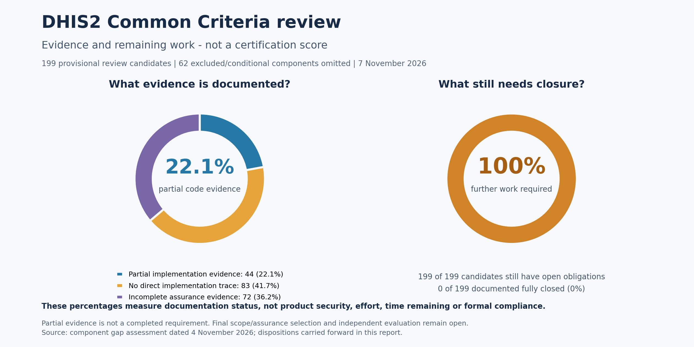

# DHIS2 Common Criteria gap report for management

**Report updated:** 13 November 2026
**Scope:** Reviewed DHIS2 web application, APIs and supporting deployment.  
**Overall status:** Open gaps prevent release sign-off for this reviewed package and any claim of Common Criteria approval.

For the later user-selected, narrower AFTA checklist, see the separate
[AFTA selected-requirements report](afta-selected-requirements-review.md). Its
element-based percentages use a different denominator from this broad report.

**9 November implementation update:** the enrolled-factor password-only downgrade
is corrected, with targeted provider/API regression evidence. Login replay protection is also implemented. Full MFA and
production acceptance remain open; see [remediation progress](afta-remediation-progress.md).

## What this means

Common Criteria asks us to define the security promises of a particular release
and deployment, demonstrate that they work, and provide evidence for independent
evaluation. Finding code or passing individual tests is only part of that work.

We have made useful engineering fixes and documented the remaining work.
**We have not completed certification or demonstrated that all application
workflows work securely in the intended deployment.** Some gaps are confirmed
problems; others mean that the required policy, configuration or proof is missing.
Missing proof does not, by itself, mean a security vulnerability exists.

## Progress charts

| Management question | Current measured result |
| --- | --- |
| What percentage is proven fully closed against the reviewed components? | **0% (0 of 199)** documented fully closed. This does **not** mean DHIS2 is 0% secure. |
| What percentage still needs work or evidence? | **100% (199 of 199)** retain open obligations. This is not an estimate that 100% of development must be redone. |
| Where is partial implementation evidence already recorded? | **22.6% (45 of 199)**. Partial evidence is not a completed requirement or a compliance score. |
| Where has no direct implementation trace been established? | **41.2% (82 of 199)**. This does not prove that the feature is absent. |
| Where is assurance evidence incomplete? | **36.2% (72 of 199)**. These need documentation, process, testing and/or evaluator evidence. |

**A defensible “percentage of the project that fits Common Criteria” is not yet
available.** The charts measure the disposition of review candidates, not the
percentage of the code that is secure, certification likelihood, time or cost.
The final evaluation target is still open. Components differ greatly in size,
and some are alternative levels; they are counted equally here only to explain
the current register. The 62 excluded/conditional components are outside the
199-component denominator and are not counted as passing requirements.

The 22.6%, 41.2% and 36.2% categories add to 100% of the register. The separate
100% “further work” chart includes all three categories because none is fully
closed. Figures come from the 4 November component dispositions plus the scoped
11 November external-broker transport update; they are not a new evaluation of every component.

Chart downloads: [PNG](charts/management-gap-dashboard.png),
[SVG](charts/management-gap-dashboard.svg), [printable PDF](charts/management-gap-dashboard.pdf).
Regenerate using `python3 docs/security/tools/render_management_charts.py`
(requires Matplotlib); the renderer checks counts against the report's baseline.

## Main gaps and business impact

| Priority | Gap in plain language | Why management should care | Required next step / proposed owner |
| --- | --- | --- | --- |
| Startup restored (user-confirmed, 9 November) | The earlier corrupt PDF dependency blocked startup; the user now confirms the project starts successfully. | This clears the reported startup incident, but does not demonstrate all workflows or certification readiness. | Retain artifact checks and validate each new release. Release engineering / operations. |
| High | Browser login fails with the selected protection against forged browser requests enabled. That protection remains enabled. | Users cannot complete normal browser login in this profile. | Fix browser integration and test login, saving data and logout without weakening protection. Web application / security teams. |
| High | Existing data-encryption configuration includes an unsafe fallback and an older encryption option; actual use needs confirmation. | Sensitive data protection may depend on deployment settings. Changing keys incorrectly could make existing data unreadable. | Inventory usage and keys; plan and test any required migration and recovery. Security / data / platform owners. |
| High | Disabled-factor downgrade and login-code reuse protections are implemented. Other verification purposes and full recovery/provider acceptance remain open. | An enrolled user's additional login protection may not behave as expected in some configurations. | Define the required behavior, implement necessary controls and test recovery and multiple servers. Authentication / security owners. |
| High | Audit records are not yet proven durable and protected in the target deployment, especially during full storage or failures. | Required evidence of who did what could be lost or altered; operational response is unclear. | Set retention and failure policy; verify persistence, permissions, capacity alerts and recovery. Operations / database / security owners. |
| High | HTTPS and Nginx support exist, but real certificate operation and all service-to-service protections remain unverified. | Sensitive information and identity checks depend on a correctly configured deployment. | Configure the real domain/certificate, verify protected connections and block bypass of the trusted proxy. Platform / network owners. |
| High | App versions and dependencies are not fully frozen and accepted; an Interpretations app error remains open. | A successful build or home page does not prove the delivered product works or can be reproduced. | Record release contents, fix the app issue and test critical user workflows. Release engineering / app owners. |
| Required for assurance | Access checks and broader web protections have only partial test coverage. | We cannot yet demonstrate that all sensitive actions reject unauthorized use. | Complete role/object/session tests and focused security testing of uploads, queries, integrations and data exposure. Application / security testing teams. |
| Blocks certification | The exact security commitments, deployment and assurance target have not been finalized. | There is no agreed, measurable basis for formal approval. | Approve the evaluation scope and security document, with the evaluator. Product / security management. |
| Blocks certification | Detailed traceability, organizational evidence and independent evaluation are incomplete. | Certification cannot be obtained from engineering fixes alone. | Finish requirement-to-code/test/process evidence and arrange independent evaluation. Engineering / quality / evaluator. |

## Work already completed

- Fixed personal access token authentication so it uses current user/token state rather than a stale local authentication snapshot.
- Fixed loss of buffered audit events when publication fails, with focused recovery tests. This does not prove audit records survive every crash or deployment failure.
- Added a component inventory, gap register and 199 individual component pages. Most detailed requirement mappings remain open; page counts are not completion percentages.
- Added configurable Nginx/HTTPS support, build diagnostics and a staged update command that builds, backs up and applies a chosen core revision.
- Recorded 262 passing core test cases and four existing skips across dated runs. The platform has 24 passing setup/policy tests. The latest 9 November MFA follow-up separately records 94 passing targeted provider, API and database cases; these are not added blindly to the earlier overlapping inventory. These are targeted checks, not a full acceptance or independent evaluation.

## Decisions and next milestones

1. **Assign accountable owners.** Name the release, authentication, data-protection, operations and evaluation leads.
2. **Agree the target.** Choose the release, enabled apps, deployment and required assurance level with the evaluator. Not every component in the standard is mandatory.
3. **Restore and demonstrate working operation.** Retain the restored startup and resolve the production browser-login blocker, then run representative user workflows.
4. **Close priority security and deployment gaps.** Verify encryption, two-factor login, audit behavior, connections and access controls against agreed policies.
5. **Complete the evidence and independent evaluation.** Accept the release only when the agreed checks pass; claim Common Criteria approval only after the relevant scheme's decision.

Owners should estimate effort and dates after confirming the target deployment
and acceptance requirements. This review does not provide a defensible completion
date or budget yet.

## Supporting detail

The underlying register has 15 gap groups and 10 additional web-testing areas.
The table above groups them for management; it does not replace their acceptance criteria.

- Scope, evidence and evaluation: G-01, G-08, G-10, G-11; W-01–W-10.
- Audit: G-02–G-04.
- Browser protection, connections and proxy: G-05–G-07.
- Release contents and web compatibility: G-09, G-12. The current corrupt PDF artifact is an additional release-integrity incident, not a separate Common Criteria component.
- Encryption and two-factor authentication: G-13–G-15.

See the [detailed gap register](../common-criteria-review.md#gap-register),
[solutions and acceptance checks](web-gap-solutions.md),
[code trace index](component-traces/README.md),
[core verification record](../common-criteria-verification.md) and
[platform validation limits](https://github.com/PardasHealth/dhis2-platform/blob/main/docs/validation.md).

### 11 November follow-up: outdated MFA state

The login guard now checks the current database factor settings, so replacing a
challenge or changing a factor cannot leave its old snapshot acceptable at proof
consumption. [Read the trace and remaining limits](afta-factor-state-freshness.md).
This improves one part of an already partial requirement; the dashboard
percentages remain unchanged and do not represent certification.

### 11 November: external audit-broker TLS

The optional external broker client can now encrypt its connection and verify the
broker certificate/hostname. One previously untraced transfer requirement gains
partial implementation/test evidence. Other connections and site acceptance
remain open; no complete requirement is closed. See the
[plain-language summary, settings and code trace](afta-external-broker-tls.md).

### 11 November: account changes during MFA login

The MFA proof guard now rejects a login snapshot after its password changes, its
account is disabled or made external-only, or its expiry has passed. Normal
permitted logins remain supported. This is a bounded check during login; existing
sessions and other providers still need separate coverage. See the
[account-state trace](afta-account-state-freshness.md). Checklist percentages are
unchanged because the improvement belongs to an already partial item.

### 11 November: reject missing/default platform encryption keys

The platform retains its generated encryption secret and enables a startup check
against missing, blank or built-in default values. It does not change keys or
algorithms. [Review the guard and legacy migration limits](afta-explicit-encryption-key.md).
This is configuration protection, not crypto approval; checklist percentages
remain unchanged.

### 11 November: preserve a pending TOTP QR seed

The legacy QR image endpoint no longer replaces an existing pending seed on
refresh. The bundled profile app and explicit enrollment POST are retained.
[Review the enrollment trace](afta-pending-qr-stability.md). The initial legacy
GET still changes state and needs a coordinated client migration; this is not
full CSRF closure. Checklist percentages are unchanged.

### 13 November: authentication audit record quality

Failed login events now retain their available address, international identities
are preserved and missing/unexpected request details do not drop a record through
an unchecked cast. Supplied field values cannot add raw line/field boundaries.
[Review the code trace and scope](afta-authentication-audit-records.md).
Durability, selected events and storage-full policy remain open; percentages do
not change for this improvement within already partial requirements.
